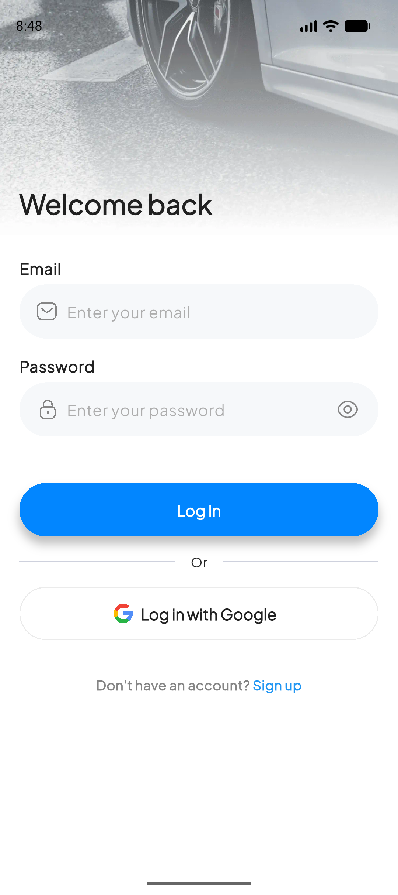
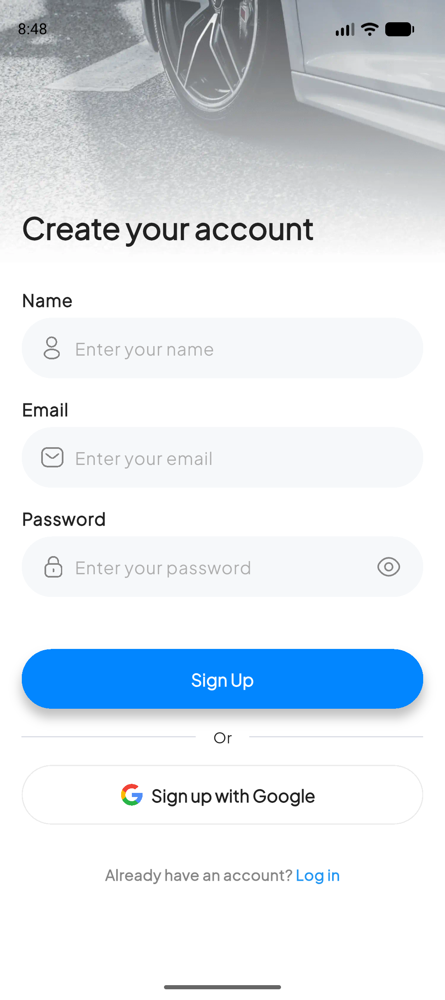

# Ryder

**Ride-hailing client: onboarding, account, and a home screen.**
Application Flutter de réservation de course, avec compte Appwrite.

<p>
  
  
</p>

Captured on an Android emulator from the debug build. The home screen opens after an account is signed in.

## What it does

- Splash and a three-step onboarding
- Account creation and sign-in
- Home after authentication

Appwrite endpoint and project id live in `lib/src/core/constants/appwrite.env.dart`. Replace those values with your own project before running.

## Stack

Flutter, Appwrite, Material 3. The project includes iOS, Android, web and desktop runners.

## Run

```bash
flutter pub get
flutter run
```

## Author

Paul Mbou — [github.com/paul-mbou](https://github.com/paul-mbou)
